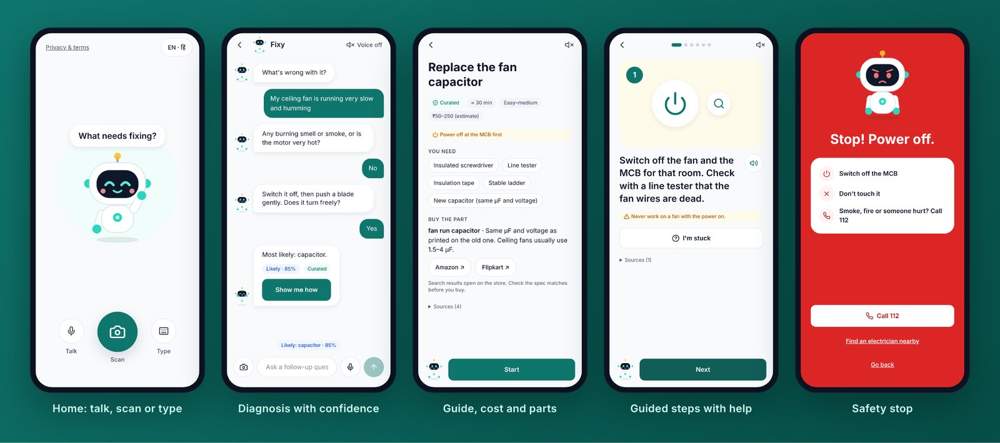
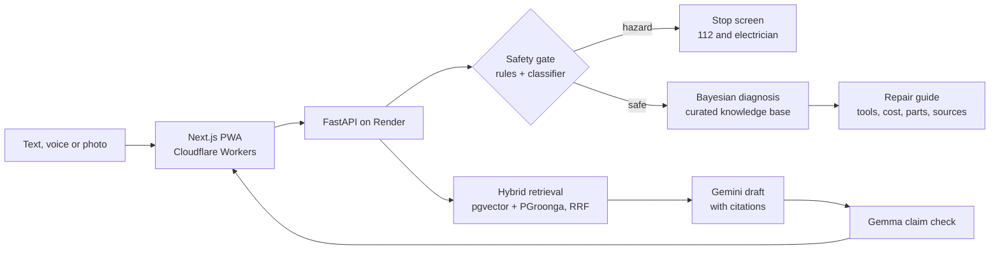
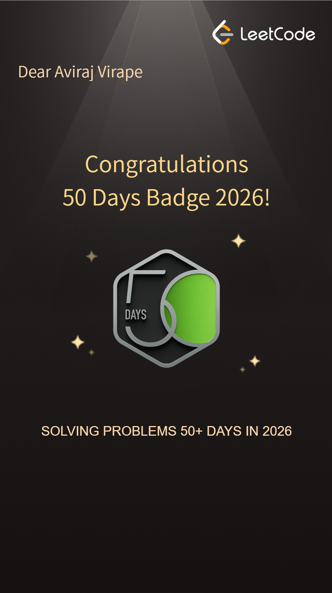
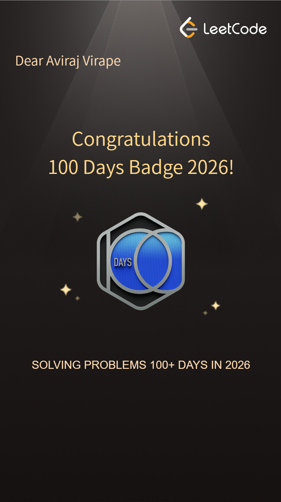

# Hi, I'm Aviraj

**Pune, India** | **Data Science and AI Engineer** | **B.E. AI & Data Science '27 (CGPA 9.28)** | **Ex-Founder, MahaGuru AI (COEP I2I)**

> Building AI systems that reason, verify, and know when to stop.

---

## Featured: Fix with Me

**An AI repair assistant for Indian households, in English, Hindi and Hinglish.** Describe what is broken by typing, talking or taking a photo. Fixy asks a few targeted questions, names the likely fault with a confidence score, walks through a safe and sourced fix, and stops the session when the job needs a professional.

| | |
|---|---|
| **Diagnosis engine** | A Bayesian engine over a curated knowledge base (ceiling fans, extension boards, headphones, battery toys) picks the most informative next question. **90.7% top-1 and 96.0% top-3** on the 94-case FixBench-IN benchmark, versus 81.3% top-1 for plain Gemini. It keeps working when the LLM quota runs out. |
| **Verified answers (RAG)** | Hybrid retrieval on Supabase (pgvector + PGroonga full-text, Reciprocal Rank Fusion) over curated guides and Wikipedia, **100% recall@5**. Gemini drafts with citations and Gemma checks every claim: **92.5% correct answers and 0% unsupported claims**, versus 87.5% and 34% for plain Gemini. Says "not sure" when the sources do not cover a question. |
| **Safety gate** | Rules in three languages plus a TF-IDF + logistic regression classifier trained on 3.8K examples and exported to a **0.68 MB pure-Python runtime (about 0.2 ms per message)**. Hazard recall rose from 67.2% to 89.1%; safety-stop recall is **100% versus 84.6%** for plain Gemini, with 0% false stops. |
| **Product** | Fixy, an animated robot guide; photo identification with location data removed on the device; voice input and spoken replies; step-by-step guides with tools, time, a rupee estimate, cited sources and part search links. |
| **Engineering** | FastAPI and Pydantic with an LLM provider chain and model fallbacks, per-IP rate limits, Docker on Render, a Next.js PWA on Cloudflare Workers, and CI with ruff, 118 pytest tests and a benchmark gate that fails the build if any safety case does not stop. |

[Benchmark report](https://github.com/aviraj1805/FixWithMe/blob/main/eval/reports/fixbench-v1-2026-10-24.md) · [QA report](https://github.com/aviraj1805/FixWithMe/blob/main/eval/reports/qa-v1-2026-10-24.md) · [Safety model card](https://github.com/aviraj1805/FixWithMe/blob/main/ml/safety_classifier/README.md) · [Design](https://github.com/aviraj1805/FixWithMe/blob/main/docs/design.md)

The API runs on Render's free tier, so the first answer can take about a minute while it wakes up. Benchmarks are small, author-written sets; the reports list their limits.

---

## MahaGuru AI

**An open-source AI mentor and personalised classroom for college students.** Rebuilt from my COEP I2I startup; live, tested and deployed.

| | |
|---|---|
| **StudentGPT** | A reflective mentor that asks before it advises. English and Hinglish safety screening on every message, a structured understanding record, and a clarity summary at the end. |
| **Classroom** | Turns a goal into a diagnostic, a personalised roadmap, generated lessons with an AI teacher, quizzes, graded projects and adaptive mastery tracking. |
| **Engineering** | FastAPI and React (TypeScript) monorepo, PostgreSQL, streamed replies over SSE, a provider-agnostic LLM layer (Gemini by default), one Docker image. |
| **Quality** | pytest on SQLite and PostgreSQL, Playwright end-to-end tests on desktop and mobile, CI on every push, and a 24-scenario evaluation suite including crisis cases. |

[Research behind it](https://mahaguru-ai.onrender.com/research) · [Architecture](https://github.com/aviraj1805/MahaGuru-V1/blob/main/docs/architecture.md) · [Evaluation method](https://github.com/aviraj1805/MahaGuru-V1/blob/main/docs/evaluation.md) · [Screenshots](https://github.com/aviraj1805/MahaGuru-V1#screenshots)

---

## Other Projects

Projects from my resume first, with live demos wherever one is available.

| Project | What it does | Links |
|---|---|---|
| **Customer Churn Prediction** | Kaggle Playground S6E3. XGBoost and LightGBM on ~594K telecom records (21 features) with 5-fold stratified CV; XGBoost reached **0.916 mean ROC-AUC**. EDA surfaced the strongest churn drivers: electronic-check payment, month-to-month contracts, fiber-optic internet and first-year customers. | [Live demo](https://churn-predictor-aviraj.onrender.com/) · [Source](https://github.com/aviraj1805/Customer-Churn-Prediction) |
| **CreditWise: Loan Approval** | scikit-learn pipeline on 950 applicants (18 features). A class-balanced Random Forest reached **0.91 F1 and 0.98 ROC-AUC**, versus 0.81 F1 for a logistic-regression baseline. Deployed with live predictions, confidence scores and feature importance. | [Live demo](https://creditwiseloanapprovall.streamlit.app/) · [Source](https://github.com/aviraj1805/CreditWise-Loan-Approval-System) |
| **IAMARS: Drone Detection and Tracking** | Team project. YOLOv8n fine-tuned on VisioDECT with a leakage-aware split: **0.965 mAP@0.5** on a 1,800-image held-out set. ByteTrack tracking, 88.5 FPS on an RTX 2050, and intercept-point prediction in 3D simulation. | [Live demo](https://huggingface.co/spaces/AvirajV/iamars-drone-tracking) · [Source](https://github.com/aviraj1805/intelligent-aerial-monitoring) |
| **PhonePe Pulse Insights** | Internship project. ETL of PhonePe Pulse JSON data (2018 to 2024) into a 9-table MySQL database, 10 SQL business questions, and a multi-page Streamlit and Plotly dashboard. | [Live charts](https://aviraj1805.github.io/portfolio/demos/phonepe/) · [Source](https://github.com/aviraj1805/PhonePe) |
| **Mental Health in Tech: EDA** | 1,251 survey responses analysed for what drives treatment-seeking: family history, work interference and employer benefits. Published as an interactive Plotly dashboard. | [Live dashboard](https://aviraj1805.github.io/portfolio/demos/mental-health/) · [Source](https://github.com/aviraj1805/mental-health-survey-eda) |
| **Tesla Stock Prediction** | Deep learning pipeline: SimpleRNN, LSTM and a tuned LSTM with 1, 5 and 10-day forecasts. | [Source](https://github.com/aviraj1805/Tesla-Stock-Price-Prediction) |
| **Real Estate Advisor** | XGBoost model predicting property profitability and future value. | [Source](https://github.com/aviraj1805/Real-Estate-Investment-Advisor-XGBoost-) |
| **Yes Bank Stock Price Prediction** | Machine learning on historical OHLC data to predict Yes Bank closing prices. | [Source](https://github.com/aviraj1805/YesBank_Internship) |
| **iTunes Music Store Analysis** | SQL analysis of the Apple iTunes database for insights on customer behaviour. | [Source](https://github.com/aviraj1805/iTunes-Data-Analysis) |

More in my [portfolio](https://aviraj1805.github.io/portfolio/) and on [GitHub](https://github.com/aviraj1805?tab=repositories).

---

## What I'm Doing

- **Building Fix with Me** — A bilingual AI repair assistant: Bayesian diagnosis, verified RAG answers and a trained safety gate
- **Maintaining MahaGuru AI** — A reflective AI mentor and an adaptive AI classroom for students, open source and live
- **Evaluating LLM systems** — Benchmarks against plain-LLM baselines, per-claim verification, safety recall and calibration
- **Shipping ML pipelines end-to-end** — From EDA and model selection to deployment and monitoring
- **Researching human-centered AI** — Presented at INMEC-2026, Keystone School of Engineering, Pune (reflective mentorship with LLMs)

---

## Experience

**Founder — MahaGuru AI** *(Jan 2024 – Nov 2025; rebuilt as open source in 2026)*
Founded an AI student-guidance platform, selected into **COEP's I2I Startup Program** for mentorship and incubation. Designed a multi-agent LLM architecture (FastAPI, React), curated a custom student-mentor dialogue dataset, and collected feedback from about 150 student users on early prototypes; the underlying research was presented at INMEC-2026. After the company shut down, rebuilt the product as an open-source platform that is now [live](https://mahaguru-ai.onrender.com).

**Data Science Intern — Innovexis** *(Feb 2026 – May 2026)*
Built an ETL pipeline loading PhonePe Pulse JSON data (2018–2024) into a 9-table MySQL database, and a multi-page Streamlit + Plotly dashboard answering 10 business questions via SQL.

---

## GitHub Activity

  

  
52 Weeks Contribution Activity

---

### LeetCode Profile

**Statistics**

**Badges Earned**

  
  
  

---

### LeetCode Heatmap

52 Weeks Submission Heatmap | Last Updated — 01/05/2026

---

## Publication

Presented **"AI-Powered Reflective Mentorship"** at INMEC-2026 (1st International Conference, Keystone School of Engineering, Pune, Mar 2026)

---

## Education

**B.E. — Artificial Intelligence & Data Science**, APCOER, Pune *(2023 – 2027, expected May 2027)* — CGPA 9.28

**HSC Science**, Yashodhara Junior College, Solapur *(2021 – 2022)* — 78%

---

## Connect

  
  
  
  

---

### Recognition

- Presented at **INMEC-2026, Keystone School of Engineering, Pune** — AI-Powered Reflective Mentorship
- Selected into **COEP's I2I Startup Program** — institutional backing for MahaGuru AI
- **Certified AI/ML Engineer** - Apna College Prime 2.0 Batch

### Philosophy

> Build systems that are useful, measurable, and honest. Ship working prototypes. Iterate from real feedback. Let the model do the heavy lifting — but understand every layer beneath it.

Random Facts

- Curated my first LLM dataset by hand: student-mentor dialogues for MahaGuru AI
- Founded an AI startup before finishing undergrad
- Competed on LeetCode to sharpen DSA fundamentals
- Believe in building small, shipping fast, and improving in production
- Based in Pune — powered by chai and curiosity

